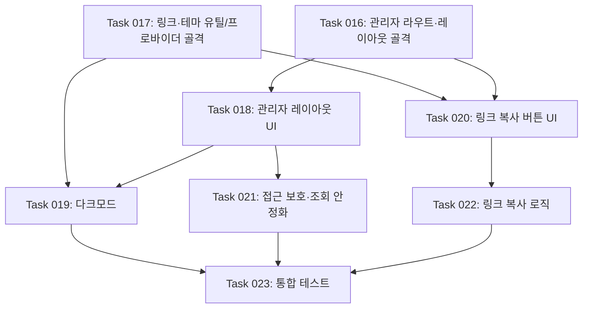

# 노션 기반 견적서 관리 시스템 고도화 개발 로드맵

완성된 MVP 위에 관리자 레이아웃 기반 견적서 목록, 클라이언트용 링크 복사, 다크모드를 더해 관리자가 웹 안에서 견적서를 찾고 바로 전달할 수 있게 한다.

## 개요

노션 기반 견적서 관리 시스템은 견적서를 발행하는 프리랜서/소규모 기업(관리자)과 견적서를 받는 클라이언트를 위한 **노션을 그대로 데이터베이스로 쓰는 경량 견적서 공유 서비스**로 다음 기능을 제공합니다:

- **견적서 조회 및 PDF 다운로드 (MVP 완료)**: 고유 URL(`/invoice/[notionPageId]`)로 견적서를 확인하고 한글 PDF로 저장
- **관리자 견적서 목록 (고도화 F020)**: 관리자 전용 레이아웃에서 인증 후 전체 견적서를 확인
- **클라이언트 링크 복사 (고도화 F021)**: 목록에서 클라이언트에게 보낼 견적서 링크를 원클릭 복사
- **다크모드 (고도화 F022)**: 시스템 설정 연동 및 수동 전환, 관리자·클라이언트 화면 모두 적용
- **관리자 해시 비밀번호 로그인 (F023)**: 평문 대신 scrypt 해시 + 세션 서명 키로 배포 환경 관리자 로그인
- **신고하기·신고 관리 (F024)**: 클라이언트가 신고를 작성·조회하고, 관리자가 접수·답변해 처리완료

### 아키텍처 원칙

- **데이터 소스는 Notion 하나**: 별도 DB·ORM을 두지 않는다.
- **서버 전용 Notion 접근**: `src/lib/services/invoice.service.ts`(`server-only`)에서만 Notion API를 호출하고 `unstable_cache`(60초, `invoices` 태그) + React `cache`로 호출 수를 줄인다.
- **견적서 URL 자체가 접근 수단**이다. 클라이언트 경로 `/invoice/[notionPageId]`와 `/api/generate-pdf`는 고도화 과정에서 변경하지 않는다.
- **클라이언트 화면은 관리자 화면과 격리**한다. 공개 견적서·신고 화면에는 로그인 여부와 무관하게 `/admin` 링크를 두지 않고, 관리자는 `/admin/invoices/[id]`에서 견적서를 본다.
- **신고는 Notion 신고 DB(`NOTION_REPORT_DATABASE_ID`)에 저장**하며, 조회 비밀번호는 scrypt 해시로만 저장한다.

## 고도화 요구사항 정의

### F020: 관리자 레이아웃으로 견적서 목록 조회

**전제**: 목록에는 클라이언트명·금액이 노출되므로 관리자 인증을 통과한 사용자만 접근할 수 있어야 한다.

| 수락 기준                                                                                             | 상태                                                                  |
| ----------------------------------------------------------------------------------------------------- | --------------------------------------------------------------------- |
| 미인증 사용자는 목록 데이터를 볼 수 없고 로그인 화면만 보인다                                         | ✅ `src/app/(admin)/admin/(dashboard)/`, `src/lib/auth/session.ts`    |
| `ADMIN_PASSWORD` 미설정(8자 미만) 시 목록 기능이 비활성화되고 안내가 표시된다                         | ✅ `src/app/(admin)/admin/layout.tsx`, `src/lib/env.ts`               |
| 로그인 실패가 IP당 10분 5회를 넘으면 차단 메시지가 표시된다                                           | ✅ `src/lib/auth/login-rate-limit.ts`, `src/app/actions.ts`           |
| Notion DB 전체를 `has_more`/`next_cursor` 기준으로 끝까지 순회해 100건 초과도 모두 표시된다           | ✅ `fetchInvoiceList` (`src/lib/services/invoice.service.ts`)         |
| 목록에 견적서 번호·클라이언트명·발행일·상태·총 금액이 표시되고 행을 누르면 상세로 이동한다            | ✅ `src/components/admin/invoice-list.tsx`                            |
| 375px 모바일에서 가로 스크롤 없이 카드형 목록으로, 640px 이상에서 테이블로 표시된다                   | ✅ `src/components/admin/invoice-list.tsx`                            |
| 관리자 화면 전체가 공통 관리자 레이아웃(헤더: 서비스명, 메뉴, 테마 토글, 로그아웃)으로 감싸진다       | ✅ `src/app/(admin)/admin/(dashboard)/layout.tsx`, `admin-header.tsx` |
| 관리자 경로가 클라이언트 경로와 분리되고(예: `/admin`), 미인증 접근 시 로그인 화면으로 리다이렉트된다 | ✅ `src/middleware.ts`(`next` 복귀) + `requireAdmin()` 서명 검증      |
| 목록 로딩 중 스켈레톤, Notion 조회 실패 시 재시도 가능한 에러 화면이 표시된다                         | ✅ `(dashboard)/loading.tsx`·`error.tsx`, Notion 429 재시도           |

**고려 사항**

- Notion `databases.query`는 한 번에 최대 100건이므로 `next_cursor` 순회가 필수다(구현됨). 견적서 수가 늘면 순회 횟수만큼 호출이 늘어나므로 60초 캐시와 새로고침 버튼(`refreshInvoicesAction`)의 태그 무효화를 유지한다.
- Notion API 속도 제한(평균 초당 3회)을 넘으면 429가 반환된다. 현재 재시도 로직이 없으므로 목록 조회 실패 시 에러 화면과 재시도 버튼으로 대응하고, 429에 한해 짧은 백오프 재시도를 둔다.
- 로그인 실패 제한과 `/api` 속도 제한은 메모리 기반이라 서버리스 인스턴스마다 따로 집계된다(현 단계에서는 허용, 범위 외 참조).

### F021: 견적서 목록에서 클라이언트용 링크 복사

| 수락 기준                                                                                                                              | 상태                                                                                |
| -------------------------------------------------------------------------------------------------------------------------------------- | ----------------------------------------------------------------------------------- |
| 목록의 각 견적서(테이블 행, 모바일 카드)에 "링크 복사" 버튼이 있다                                                                     | ✅ `src/components/admin/copy-link-button.tsx`, `invoice-list.tsx`                  |
| 복사되는 값은 클라이언트가 바로 열 수 있는 절대 URL `https://<배포 도메인>/invoice/<하이픈 없는 32자리 ID>`이다                        | ✅ `src/lib/invoice-url.ts`                                                         |
| 복사한 URL을 로그인하지 않은 브라우저에서 열면 해당 견적서가 표시된다                                                                  | ✅ `src/app/invoice/[id]/page.tsx` — 비로그인 컨텍스트에서 확인                     |
| 복사 성공 시 "링크를 복사했습니다" 토스트, 실패 시 실패 토스트가 표시된다                                                              | ✅ `sonner` ("견적서 링크를 복사했습니다")                                          |
| Clipboard API를 쓸 수 없는 환경(HTTP, 권한 거부, 구형 브라우저)에서도 대체 수단으로 복사하거나 직접 선택·복사할 수 있는 URL이 제공된다 | ✅ `src/hooks/use-copy-to-clipboard.ts` (`execCommand` 폴백) + 수동 복사 다이얼로그 |
| 복사 버튼을 눌러도 상세 페이지로 이동하지 않는다                                                                                       | ✅ 테이블 `relative z-10`, 모바일 카드 "링크 영역 + 버튼" 구조                      |
| 버튼은 키보드로 접근 가능하고 견적서 번호가 포함된 `aria-label`을 가진다                                                               | ✅ `"<견적서 번호> 링크 복사"`                                                      |

**결정 사항: 배포 도메인 획득 방식**

| 방식                               | 장점                                                                 | 단점                                                      |
| ---------------------------------- | -------------------------------------------------------------------- | --------------------------------------------------------- |
| A. 환경 변수 `NEXT_PUBLIC_APP_URL` | 프리뷰 배포·로컬에서 열어도 항상 운영 도메인 링크가 복사됨           | 환경 변수 누락 시 잘못된 링크, 도메인 변경 시 재배포 필요 |
| B. `window.location.origin`        | 설정 불필요, 현재 접속 도메인과 항상 일치                            | 프리뷰/로컬 주소가 그대로 클라이언트에게 전달될 위험      |
| **권장: A + B 폴백**               | `NEXT_PUBLIC_APP_URL`이 있으면 사용, 없으면 `window.location.origin` | 폴백 사용 시 개발 환경에서 콘솔 경고                      |

### F022: 다크모드

| 수락 기준                                                                                                                | 상태                                                                                   |
| ------------------------------------------------------------------------------------------------------------------------ | -------------------------------------------------------------------------------------- |
| Tailwind v4 CSS 기반 다크 변형이 정의되어 있다 (`tailwind.config`가 아니라 `globals.css`의 `@custom-variant dark`)       | ✅ `src/app/globals.css` — 인쇄 매체에서는 제외                                        |
| 다크 테마 색상 토큰이 정의되어 있다                                                                                      | ✅ `src/app/globals.css`의 `.dark { ... }` (shadcn 기본 토큰)                          |
| 테마 토글이 관리자 화면과 견적서 조회 페이지에 모두 있다 (사용자 요청으로 시스템 선택지 없이 클릭 시 라이트 ↔ 다크 전환) | ✅ `src/components/theme-toggle.tsx`, `admin-header.tsx`, `src/app/invoice/layout.tsx` |
| 처음 방문 시 OS 설정(`prefers-color-scheme`)을 따르고, 토글을 누르기 전까지는 OS 설정 변경이 즉시 반영된다               | ✅ `src/app/providers.tsx` (`next-themes`, `defaultTheme="system"`)                    |
| 선택한 테마가 새로고침·페이지 이동 후에도 유지된다                                                                       | ✅ localStorage `theme`                                                                |
| 새로고침 시 라이트 → 다크로 깜빡이지 않고(FOUC 없음) 콘솔에 hydration 경고가 없다                                        | ✅ `next-themes` 인라인 스크립트, `suppressHydrationWarning`                           |
| 모든 화면(관리자 목록·로그인, 견적서 조회, 이용 안내, 404, 에러, 로딩)의 텍스트·배지·테이블이 다크 테마에서 읽을 수 있다 | ✅ 스크린샷 점검 — 기존 토큰·배지 색상 유지                                            |
| 다운로드되는 PDF는 테마와 무관하게 항상 라이트(흰 배경·검은 글씨)다                                                      | ✅ 서버 생성(`@react-pdf/renderer`), 다크 상태에서 200 `application/pdf` 확인          |
| 브라우저 인쇄(Ctrl+P) 결과도 다크 테마에서 라이트로 출력된다                                                             | ✅ `globals.css` `@media print` 라이트 토큰 + 인쇄 제외 `dark` 변형                    |

**결정 사항: `next-themes` 도입 (권장)**

- `next-themes`는 `<head>` 인라인 스크립트로 hydration 전에 `<html class="dark">`를 적용해 FOUC를 막고, 로컬 스토리지 저장·시스템 설정 감지·탭 간 동기화를 제공한다. 직접 구현 대비 코드가 적고 shadcn/ui 공식 가이드와 일치한다.
- 직접 구현 시에도 동일한 인라인 스크립트와 `matchMedia` 구독을 작성해야 하므로 도입을 권장한다.

### F023: 관리자 해시 비밀번호 로그인

**배경**: 배포 환경에 평문 `ADMIN_PASSWORD`를 두지 않고, 비밀번호 원문은 관리자 본인만 알게 한다.

| 수락 기준                                                                                                             | 상태                                     |
| --------------------------------------------------------------------------------------------------------------------- | ---------------------------------------- |
| `npm run hash-password`로 비밀번호를 화면에 표시하지 않고 `ADMIN_PASSWORD_HASH`(scrypt)와 `SESSION_SECRET`을 생성한다 | ✅ `scripts/hash-password.mjs`           |
| 해시와 32자 이상 `SESSION_SECRET`이 있으면 해시로 로그인하고, 평문 `ADMIN_PASSWORD`는 무시한다                        | ✅ `src/lib/env.ts` `getAdminAuthConfig` |
| 세션 쿠키는 `SESSION_SECRET`+해시로 서명해, 해시가 공개돼도 쿠키를 위조할 수 없다                                     | ✅ `src/lib/auth/session.ts`             |
| 로컬 개발은 평문 `ADMIN_PASSWORD`(8자 이상)로 계속 로그인할 수 있다                                                   | ✅                                       |
| 설정이 없으면 배포용·로컬용 설정 방법을 안내한다                                                                      | ✅ `admin-password-notice.tsx`           |

### F024: 신고하기 및 신고 관리

**상태 흐름**: 작성(신고 등록) → 접수(관리자가 "접수" 클릭) → 처리완료(관리자 답변 등록)

| 수락 기준                                                                                                                                | 상태                                                     |
| ---------------------------------------------------------------------------------------------------------------------------------------- | -------------------------------------------------------- |
| 견적서·이용 안내 화면 상단에 "신고하기"·"신고 목록" 버튼이 있다                                                                          | ✅ `src/components/layout/public-header.tsx`             |
| 견적서와 무관한 일반 신고로 작성자 이름·제목·내용·조회 비밀번호를 입력해 등록하고, 등록 후 작성 내용을 보여 준다                         | ✅ `/report`, `report-form.tsx`                          |
| 신고 목록(게시판)에 최근 글 순으로 순번·제목·작성자·작성일·상태를 10개씩 보여 주고, 작성자 이름은 서버에서 가린 값(예: 민*성)만 전달한다 | ✅ `/report/list`, `report-board.tsx`, `src/lib/mask.ts` |
| 목록에서 글을 누르면 조회 비밀번호를 입력해 진행 단계·내용·관리자 답변을 확인한다 (비밀번호 입력 전에는 내용·실명 미노출)                | ✅ `/report/list/[id]`, `report-unlock.tsx`              |
| 신고 화면에서 보던 견적서(또는 이용 안내)로 돌아갈 수 있다                                                                               | ✅ `?from=` (견적서·이용 안내 경로만 허용)               |
| 관리자 "신고 관리"에서 상태 필터·건수와 함께 목록을 보고, 상세에서 접수·답변 등록(처리완료)·답변 수정을 한다                             | ✅ `/admin/reports`, `report-admin-panel.tsx`            |
| 상태 전환 규칙(작성 → 접수 → 처리완료)을 서버에서 검증한다                                                                               | ✅ `report.service.ts`                                   |
| 조회 비밀번호는 해시로만 저장하고, 작성은 IP당 10분 5건, 조회 실패는 IP당 10분 10회로 제한한다                                           | ✅ `src/app/report/actions.ts`                           |
| 신고 DB 미설정 시 "준비 중" 안내를 표시한다                                                                                              | ✅ `report-unavailable.tsx`                              |

**Notion 설정**: 연동에 공유한 페이지에서 `npm run setup:report-db -- <페이지 URL>` 실행 → 출력된 `NOTION_REPORT_DATABASE_ID`를 `.env.local`·Vercel에 추가

## 개발 워크플로우

1. **작업 계획**

- 기존 코드베이스를 학습하고 현재 상태를 파악
- 새로운 작업을 포함하도록 `ROADMAP.md` 업데이트
- 우선순위 작업은 마지막 완료된 작업 다음에 삽입

2. **작업 생성**

- 기존 코드베이스를 학습하고 현재 상태를 파악
- `/tasks` 디렉토리에 새 작업 파일 생성 (현재 디렉토리가 없으므로 첫 작업 시 `000-sample.md` 템플릿과 함께 생성)
- 명명 형식: `XXX-description.md` (예: `016-admin-layout.md`)
- 고수준 명세서, 관련 파일, 수락 기준, 구현 단계 포함
- **API/비즈니스 로직 작업 시 "## 테스트 체크리스트" 섹션 필수 포함 (Playwright MCP 테스트 시나리오 작성)**
- 예시를 위해 `/tasks` 디렉토리의 마지막 완료된 작업 참조. 예를 들어, 현재 작업이 `018`이라면 `017`과 `016`을 예시로 참조.
- 이러한 예시들은 완료된 작업이므로 내용이 완료된 작업의 최종 상태를 반영함 (체크된 박스와 변경 사항 요약). 새 작업의 경우, 문서에는 빈 박스와 변경 사항 요약이 없어야 함. 초기 상태의 샘플로 `000-sample.md` 참조.

3. **작업 구현**

- 작업 파일의 명세서를 따름
- 기능과 기능성 구현
- **API 연동 및 비즈니스 로직 구현 시 Playwright MCP로 테스트 수행 필수**
- 각 단계 후 작업 파일 내 단계 진행 상황 업데이트
- 구현 완료 후 Playwright MCP를 사용한 E2E 테스트 실행 (시나리오는 `tests/e2e/`에 누적)
- 테스트 통과 확인 후 다음 단계로 진행
- `npm run check-all`, `npm run build` 통과 확인
- 각 단계 완료 후 중단하고 추가 지시를 기다림

4. **로드맵 업데이트**

- 로드맵에서 완료된 작업을 ✅로 표시

## 개발 단계

### Phase 1~4: MVP 구축 ✅

- **Task 001~012: 견적서 조회 MVP** ✅ - 완료
  - 참고: MVP 단계의 개별 작업 파일은 남아 있지 않음. 명세는 `docs/PRD.md` 참조
  - ✅ Next.js 15 App Router 골격, 공통 레이아웃(`PageContainer`), shadcn/ui 기본 컴포넌트
  - ✅ 견적서/항목 타입(`src/types/invoice.ts`)과 Zod 환경 변수 검증(`src/lib/env.ts`)
  - ✅ Notion 클라이언트·속성 파서(`src/lib/notion/`), 견적서 DB 소속 페이지만 허용, 25개 초과 relation 전체 조회
  - ✅ 견적서 조회 페이지, 로딩 스켈레톤, 에러/404 페이지 (F001, F002, F011)
  - ✅ PDF 생성 API(`GET /api/generate-pdf?id=`)와 다운로드 버튼, 나눔고딕 폰트 (F003)
  - ✅ 반응형 레이아웃과 이용 안내 페이지 (F012)
  - ✅ `/api` 속도 제한 미들웨어(IP당 분당 10회), 보안 헤더, 검색엔진 노출 차단

### Phase 5: 관리자 목록 기본 기능 ✅

- **Task 013: 관리자 비밀번호 인증 구현** ✅ - 완료
  - 참고: 작업 파일 없음. v3.1 계획(`/admin` 라우트, 미들웨어 인증, 사이드바)과 달리 `/` 페이지 내 분기로 구현됨
  - ✅ `ADMIN_PASSWORD` 기반 로그인, 미설정 시 안내 화면
  - ✅ HMAC-SHA256 서명 httpOnly 쿠키 세션(7일), 타이밍 공격 방지 비교
  - ✅ React Hook Form + Zod 로그인 폼, Server Action(`loginAction`/`logoutAction`)
  - ✅ 로그인 실패 IP당 10분 5회 제한

- **Task 014: 견적서 목록 조회 구현** ✅ - 완료
  - ✅ `next_cursor` 순회로 Notion 견적서 DB 전체 조회, 발행일 내림차순
  - ✅ 테이블(640px 이상)·카드(모바일) 반응형 목록, 행 클릭 시 상세 이동
  - ✅ Notion 캐시 무효화 새로고침, 상세 페이지의 관리자 전용 "목록으로" 링크

- **Task 015: 목록 검색·상태 필터 구현** ✅ - 완료
  - ✅ 견적서 번호·클라이언트명 검색(클라이언트 측)
  - ✅ 상태 필터(전체/대기/승인/거절)와 결과 건수 표시
  - 참고: v3.1에 완료로 표시된 날짜 범위 필터·검색어 하이라이팅·페이지네이션·컬럼 정렬은 실제로 미구현이며, 이번 요구사항 범위가 아니므로 "향후 고려 사항"으로 이동

### Phase 6: 고도화 골격 구축 ✅

- **Task 016: 관리자 라우트 분리 및 레이아웃 골격 구축 (F020)** ✅ - 완료 (`tasks/016-admin-layout.md`)
  - ✅ `src/app/(admin)/admin/` 라우트 그룹: 공통 `layout.tsx`(비밀번호 미설정 안내), `login/page.tsx`(헤더 없는 로그인), `(dashboard)/`의 `layout.tsx`(인증 확인 + 헤더)·`page.tsx`(목록)·`loading.tsx`·`error.tsx`
  - ✅ `/`는 `/admin`으로 리다이렉트(결정 사항 1), 클라이언트 경로 `/invoice/[id]`·`/invoice/guide`·`/api/generate-pdf`는 변경 없음
  - ✅ `src/components/admin/admin-header.tsx`: 서비스명, 메뉴(견적서 목록), 테마 토글 자리, 로그아웃 버튼(`ListActions`에서 이동)
  - ✅ 상세 페이지 "목록으로" → `/admin`, `not-found.tsx`의 "홈으로" 버튼 제거(이용 안내만 유지) — 이후 관리자용 상세 `/admin/invoices/[id]`로 분리하고 공개 화면에서는 제거
  - ✅ 미인증 `/admin` 접근 시 `requireAdmin()`이 `/admin/login`으로 리다이렉트(미들웨어 보호·`next` 복귀는 Task 021)

- **Task 017: 링크·테마 공통 유틸 및 프로바이더 골격 정의 (F021, F022)** ✅ - 완료 (`tasks/017-link-theme-foundation.md`)
  - ✅ `src/lib/invoice-url.ts`: `getInvoicePath`, `getInvoiceUrl`, `getAppOrigin` — `invoice-list.tsx`의 `getInvoiceHref` 이동
  - ✅ `src/lib/public-env.ts`: `NEXT_PUBLIC_APP_URL`(선택, http/https만) 검증, `.env.example` 추가
  - ✅ `src/app/providers.tsx`: 테마·툴팁·토스트 프로바이더를 루트 레이아웃에 연결
  - ✅ shadcn/ui 추가: `sonner`, `tooltip`, `dialog` (`dropdown-menu`는 토글 방식 변경으로 제거)

### Phase 7: UI/UX 완성 ✅

- **Task 018: 관리자 레이아웃 UI 완성 (F020)** ✅ - 완료 (`tasks/018-admin-layout-ui.md`)
  - ✅ 헤더 반응형: 375px 서비스명·아이콘 버튼만, 640px 이상 메뉴·텍스트 버튼
  - ✅ 로그아웃은 헤더로, 새로고침은 목록 상단 유지, 로그인은 헤더 없는 중앙 카드
  - ✅ 목록 스켈레톤(카드·테이블형), 에러 화면(안내·오류 코드·"다시 시도")
  - 참고: 768px은 별도 확인하지 않음(640px 이상은 테이블 레이아웃 동일)

- **Task 019: 다크모드 테마 시스템 및 토글 구현 (F022)** ✅ - 완료 (`tasks/019-dark-mode.md`)
  - ✅ `next-themes` `ThemeProvider`(class, system 기본), `<html suppressHydrationWarning>`
  - ✅ `src/components/theme-toggle.tsx`: 클릭 시 라이트 ↔ 다크 전환 버튼, 아이콘은 `dark:` 클래스로 전환
  - ✅ 관리자 헤더, 견적서 조회·이용 안내(`src/app/invoice/layout.tsx`), 로그인·안내·404(우측 상단)에 토글 배치
  - ✅ `dark` 변형을 `@media not print`로 감싸고 인쇄 시 라이트 토큰 강제, 인쇄 시 버튼·헤더 숨김
  - ✅ 다크 대비 점검: 기존 토큰·배지 색상으로 충분해 별도 수정 없음

- **Task 020: 목록 링크 복사 버튼 UI 구현 (F021)** ✅ - 완료 (`tasks/020-copy-link-button-ui.md`)
  - ✅ `src/components/admin/copy-link-button.tsx`: 아이콘 버튼 + 툴팁, 복사 후 2초 체크 아이콘
  - ✅ 테이블 액션 열(`relative z-10`), 모바일 카드 "링크 영역 + 버튼" 구조로 변경
  - ✅ 수동 복사 다이얼로그(URL 선택된 읽기 전용 입력), 모바일 터치 영역 40px

### Phase 8: 핵심 기능 구현 ✅

- **Task 021: 관리자 접근 보호 및 목록 조회 안정화 (F020)** ✅ - 완료 (`tasks/021-admin-guard-stability.md`)
  - ✅ `src/middleware.ts`: `/admin` 세션 쿠키 없음/만료 시 `/admin/login?next=` 리다이렉트(서명 검증은 서버 `requireAdmin()`)
  - ✅ `next` 복귀, 외부·프로토콜 상대 URL 거부(`getSafeNextPath`)
  - ✅ `/admin` 경로는 `/api` 속도 제한에서 제외
  - ✅ Notion 429에 한해 `Retry-After`(최대 5초) 기반 최대 2회 재시도(`withRateLimitRetry`)

- **Task 022: 링크 복사 로직 구현 (F021)** ✅ - 완료 (`tasks/022-copy-link-logic.md`)
  - ✅ `NEXT_PUBLIC_APP_URL` 우선, 없으면 `window.location.origin` 폴백(개발 환경 경고), 끝 슬래시 정규화
  - ✅ `src/hooks/use-copy-to-clipboard.ts`: Clipboard API → `execCommand` 폴백 → 수동 복사 UI
  - ✅ `sonner` 성공·실패 토스트

- **Task 023: 고도화 기능 통합 테스트** ✅ - 완료 (`tasks/023-integration-test.md`)
  - ✅ `tests/e2e/admin.spec.ts` 추가, `tests/e2e/invoice.spec.ts` 실제 화면 기준으로 수정
  - ✅ 로그인 → 목록 → 링크 복사 → 비로그인 열람 → PDF 응답, 다크/라이트 × 375px/1280px 확인
  - ✅ 잘못된 비밀번호, Notion 키 오류 에러 화면, 클립보드 권한 거부 확인
  - 미실행: 견적서 0건 빈 상태, 로그인 5회 실패 차단, 실제 Notion 429 재시도

### Phase 9: 운영 보완 및 신고 기능 ✅

- **Task 024: 관리자 해시 비밀번호 로그인 (F023)** ✅ - 완료 (`tasks/024-admin-password-hash.md`)
  - ✅ scrypt 해시 유틸(`src/lib/auth/password-hash.ts`)과 생성 스크립트(`npm run hash-password`)
  - ✅ `ADMIN_PASSWORD_HASH` + `SESSION_SECRET` 우선, 평문 `ADMIN_PASSWORD`는 로컬용으로 유지

- **Task 025: 클라이언트 견적서 화면 격리 (F020 보완)** ✅ - 완료 (`tasks/025-client-view-isolation.md`)
  - ✅ 공개 `/invoice/[id]`에서 관리자 링크 제거, 관리자용 상세 `/admin/invoices/[id]` 추가(목록으로·링크 복사·클라이언트 화면)
  - ✅ 견적서 본문 `InvoiceView` 공용 컴포넌트

- **Task 026: 신고하기·신고 관리 (F024)** ✅ - 완료 (`tasks/026-report.md`)
  - ✅ Notion 신고 DB 생성 스크립트(`npm run setup:report-db`), 신고 서비스(`report.service.ts`)
  - ✅ 신고 작성(`/report`)·신고 목록 게시판(`/report/list`)·비밀글 열람(`/report/list/[id]`), 상단 바 버튼과 돌아가기
  - ✅ 작성자 이름 입력, 공개 목록에서는 이름 가리기(민*성), 예전 `/report/lookup`은 `/report/list`로 이동
  - ✅ 관리자 신고 관리(`/admin/reports`, `/admin/reports/[id]`): 접수·답변 등록·답변 수정
  - ✅ 요청 제한 공용 모듈(`src/lib/rate-limiter.ts`), Notion 재시도 공용 모듈(`src/lib/notion/retry.ts`)

## Playwright MCP 테스트 시나리오

전제: `npm run dev` 실행, `.env.local`에 `NOTION_API_KEY`, `NOTION_DATABASE_ID`, `ADMIN_PASSWORD` 설정, 견적서 1건 이상 존재.

### F020 시나리오 (Task 018, 021)

1. 쿠키 없이 `/admin` 이동 → `/admin/login`으로 리다이렉트, 목록 데이터(클라이언트명·금액) 미노출 확인
2. 잘못된 비밀번호 입력 → 에러 메시지, 5회 실패 후 차단 메시지 확인
3. 올바른 비밀번호 로그인 → `/admin` 목록과 관리자 헤더 표시, `next` 파라미터가 있으면 해당 경로로 복귀
4. `browser_resize` 375px → 카드 목록·가로 스크롤 없음, 1280px → 테이블 표시
5. 행 클릭 → `/admin/invoices/<id>` 관리자용 상세 이동, "목록으로" 링크 확인 (공개 `/invoice/<id>`에는 관리자 링크 없음)
6. 로그아웃 → `/admin` 재접근 시 로그인 화면
7. `/admin/login?next=https://example.com` 로그인 → 외부로 이동하지 않음

### F021 시나리오 (Task 020, 022)

1. 로그인 → 목록 → 첫 행 "링크 복사" 클릭 → 성공 토스트 표시, 상세 페이지로 이동하지 않음
2. `browser_evaluate`로 `navigator.clipboard.readText()` 호출(권한 부여) → 값이 `<NEXT_PUBLIC_APP_URL 또는 origin>/invoice/<32자리 ID>` 형식인지 확인
3. 새 탭/비로그인 컨텍스트에서 복사한 URL 이동 → 견적서 표시, "목록으로" 링크 없음
4. 375px에서 카드의 복사 버튼으로 1~2 반복
5. `navigator.clipboard`를 제거하거나 `writeText`가 reject되도록 주입 → 폴백 동작 또는 수동 복사 UI 노출, 실패 시 실패 토스트
6. 키보드 Tab으로 버튼 포커스 → Enter로 복사 동작

### F022 시나리오 (Task 019)

1. `browser_emulate_media`로 `colorScheme: dark` → 첫 방문 시 `<html>`에 `dark` 클래스, 배경색이 다크 토큰
2. 토글에서 "라이트" 선택 → 새로고침 후에도 라이트 유지(로컬 스토리지 `theme` 값 확인)
3. 토글을 누르지 않은 첫 방문 상태에서 `colorScheme`을 light ↔ dark로 변경 → 즉시 반영, 토글 클릭 시 라이트 ↔ 다크 전환
4. 다크 상태로 새로고침 직후 스크린샷 → 라이트 깜빡임 없음, `browser_console_messages`에 hydration 경고 없음
5. 관리자 목록·로그인·견적서 조회·이용 안내·404 페이지를 다크 테마로 순회하며 스크린샷 확인
6. 다크 상태에서 PDF 다운로드 → 응답 `Content-Type: application/pdf`, 생성된 PDF가 흰 배경임을 확인
7. `browser_emulate_media`로 `media: print` → 라이트 색상으로 렌더링 확인

### F024 시나리오 (Task 026)

1. 견적서 화면 → "신고하기" → URL에 `?from=/invoice/<ID>`, 빈 제출 시 검증 메시지
2. 작성자 이름·제목·내용·조회 비밀번호 입력 → "신고 완료" → 작성 내용과 상태 "작성" 표시
3. "신고 목록으로 이동" → 내 글이 "민*성"처럼 가린 이름으로 표시, 페이지 HTML에 실명 없음 → 글 선택 → 틀린 비밀번호 거부, 맞으면 실명·내용·답변 표시
4. 관리자 "신고 관리" → 필터 건수 확인 → 상세 → "접수" → 신고자 화면 "접수"
5. 빈 답변 검증 → 답변 등록 → 관리자·신고자 화면 모두 "처리완료"와 답변 표시, 필터 건수 갱신
6. 신고 화면 "돌아가기" → 원래 견적서, `?from=/admin`처럼 허용되지 않은 경로는 돌아가기 링크 없음
7. 375px에서 가로 스크롤 없음

## 결정 사항

1. **관리자 경로**: 목록을 `/admin`으로 옮기고 `/`를 리다이렉트할지, `/`를 관리자 목록으로 유지하고 레이아웃만 씌울지. 이 로드맵은 `/admin` 분리를 전제로 작성함.
2. **배포 도메인**: `NEXT_PUBLIC_APP_URL` 환경 변수 + `window.location.origin` 폴백(권장) / 환경 변수만 / origin만.
3. **`next-themes` 도입**: 권장. 미도입 시 Task 019에서 인라인 스크립트·시스템 감지를 직접 구현.
4. **관리자 비밀번호**: 배포 환경은 해시(`ADMIN_PASSWORD_HASH`) + `SESSION_SECRET` 방식으로 결정(2026-11-23).
5. **신고 방식**: 견적서와 무관한 일반 신고, 신고자는 게시판(작성자 이름 가림)에서 글을 골라 조회 비밀번호로 열람, 저장소는 Notion 신고 DB로 결정(2026-11-23).
6. **견적서 조회 페이지의 테마 토글 노출**: 클라이언트 화면에도 토글을 둘지(현재 기준: 둔다), 시스템 설정만 따를지.

## 기술적 의존성 관계

- Task 016과 017은 서로 독립적이라 병렬 진행 가능하다.
- Task 019(다크모드)는 관리자 헤더에 토글을 넣기 위해 Task 018 이후가 자연스럽지만, 견적서 조회 페이지 적용분은 Task 017 이후 바로 착수할 수 있다.

## 향후 고려 사항 (범위 외)

이번 3가지 요구사항에 직접 필요하지 않아 Task에서 제외한 항목이다. 필요 시 Task 027 이후 번호로 추가한다.

- **목록 고도화 (v3.1 Task 014·015 미구현분)**: 페이지네이션 UI, 컬럼 정렬, 발행일 날짜 범위 필터, 검색어 하이라이팅, URL 쿼리 기반 검색 상태·디바운싱
- **링크 공유 확장 (v3.1 Task 016·018)**: 짧은 URL, QR 코드, 메일(`mailto`)·카카오톡·텔레그램 등 메신저 공유 버튼, 링크 미리보기 메타데이터, 링크 조회수 통계
- **다크모드 확장 (v3.1 Task 021)**: 다크모드 설정 페이지, 테마 전환 애니메이션
- **보안·운영**: 메모리 기반 속도 제한(로그인·신고 작성·조회 포함)의 Redis(Upstash) 전환, CSP 헤더, GitHub Actions CI, Husky + lint-staged 설정(CLAUDE.md에는 명시되어 있으나 `package.json`에 없음)
- **문서 정합성**: `docs/admin-guide.md`, `docs/api-documentation.md`가 실제로 없는 기능(`/admin-login`, `SESSION_SECRET`, `NEXT_PUBLIC_BASE_URL`, `generateInvoiceUrl`, `useClipboard`, `CopyButton`, `ShareButton` 등)을 설명하고 있어 재작성 필요. 이번 고도화 완료 시점에 실제 구현 기준으로 맞추는 것을 권장
- **PRD 향후 개선 방향**: 견적서 상태 변경(클라이언트 승인/거절 응답), 열람 트래킹, 이메일 자동 발송(Resend), 만료 알림, 다중 템플릿, 다국어, 전자 서명, 버전 관리
- **수치 성공 지표**: v3.1의 "관리자 작업 효율 30% 향상" 등은 측정 근거가 없어 제외. 필요 시 Vercel Analytics 도입 후 기준선을 측정해 설정

## v3.1 대비 Task 매핑

| v3.1 Task                                                            | 이번 로드맵                                   |
| -------------------------------------------------------------------- | --------------------------------------------- |
| 013 관리자 레이아웃·인증 (미구현: 레이아웃, `/admin`, 미들웨어 보호) | 016, 018, 021                                 |
| 014·015 목록 (미구현: 페이지네이션·정렬·기간 필터·하이라이트)        | 향후 고려 사항                                |
| 016 고유 링크 생성                                                   | 017, 022                                      |
| 017 원클릭 링크 복사                                                 | 020, 022                                      |
| 018 링크 공유 통합                                                   | 향후 고려 사항                                |
| 019~020 다크모드 시스템·스타일링                                     | 019                                           |
| 021 테마 토글                                                        | 019 (설정 페이지·애니메이션은 향후 고려 사항) |
| 022 통합 테스트                                                      | 023                                           |
| 023~024 최적화·문서화                                                | 향후 고려 사항                                |

---

**문서 버전**: v4.1
**최종 업데이트**: 2026-11-23
**진행 상황**: MVP(Task 001~012), Phase 5(Task 013~015), 고도화 Task 016~023, 운영 보완·신고 Task 024~026 완료
